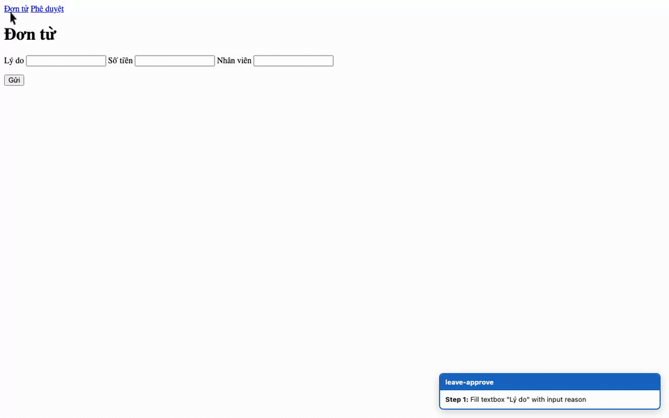
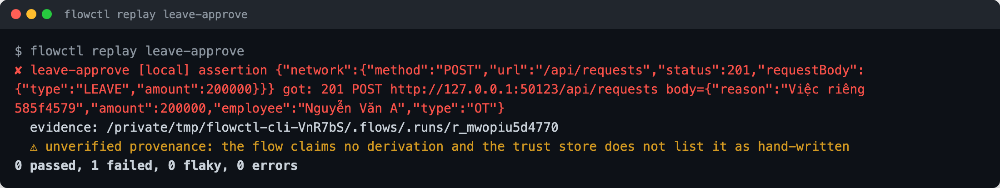
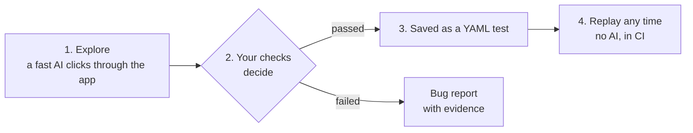

# flowctl

**Test your web app with an AI agent, without letting the AI decide whether the test passed.**

When an AI coding agent (Claude Code, Kiro, Codex) tests a web app today, it clicks through the app and then
tells you "it works". That answer is the model's opinion. It can be wrong, and it can change from one run to the
next.

flowctl splits the job in two:

1. **A fast AI model finds the way through your app** (which buttons to click, what to type).
2. **Checks you write in advance decide pass or fail**: "this request returns 201", "this text is on the page",
   "the URL ends with `/approvals`". The AI never gets a vote.

Once a test passes, flowctl saves it as a small YAML file. From then on it **replays with no AI at all**: fast, free
and the same every time, on your machine or in CI.



*A saved test replaying with no AI. The box in the corner shows each step. ([MP4](docs/media/replay-demo.mp4))*

## Why this matters

### What a failure looks like

In this run every step worked and the page said the request was approved, so someone (or an AI) watching the
screen would call it a pass. But the app sent the wrong data: `"type":"OT"` instead of `"LEAVE"`. A check on the
network request caught it:



### In numbers

On flowctl's own test app (4 user journeys, on the working app and with 13 planted bugs):

| | flowctl replay | AI agent checking by itself (first 3-run sample) |
|---|---|---|
| Correct verdicts | 51 of 51 | 3 of 3 |
| Time per test | about 3.6 s | 31–82 s |
| Steps the agent spends | 1 call | 15–42 tool calls |
| AI cost per test | none | about 1.4 Kiro credits |

The AI agent can get it right; it pays the full price every time. Method, raw results and caveats:
[docs/benchmarks/compare](docs/benchmarks/compare/README.md).

## Is it for me?

Use flowctl if you:

- build or test web apps and already use an AI coding agent;
- want tests that fail for real bugs, not because a model changed its mind;
- want to run the same checks in CI for free.

It is an **early preview (v0.3)**: it works and is tested, but commands may still change. Run it only on apps and
environments you are allowed to change.

## How it works



1. **Explore.** You give a goal ("submit a leave request"), a start page and your checks. A fast model called
   *System 1* (by default TypeSafe Jev) picks one action at a time. If it gets stuck, it asks your coding agent
   once and carries on.
2. **Decide.** Only your checks decide the result. If the AI says "done" but a check fails, the test fails.
3. **Save.** A passing run is saved as a test file, but only after it passes once more with no AI.
4. **Replay.** Saved tests run with no AI, in a few seconds each. Every run keeps evidence you can attach to a
   bug: a screenshot, network and console logs and a Playwright trace, with passwords and secrets hidden.

## Quick start

You need Node 22.12 or newer.

**1. Install** (releases are on GitHub, not npm):

```bash
npm install --save-dev https://github.com/connext-solutions/flowctl/releases/download/v0.3.2/flowctl-cli-0.3.2.tgz
npx playwright install chromium
```

**2. Describe your app** in `flowctl.config.yaml` at the root of your repo:

```yaml
flowsDir: .flows
defaultEnv: local
envs:
  local: { baseUrl: http://localhost:4200, loginUrl: /login }
profiles:
  employee: { locale: en-US }
```

An *env* is where the app runs (local, staging). A *profile* is a user you test as.

**3. Set up this machine** (once). It asks a few questions, such as which environments are production, so
flowctl never writes to them:

```bash
npx flowctl trust init
```

**4. Log in once per user.** A browser opens and you log in yourself; flowctl never sees your password:

```bash
npx flowctl login employee --env local
```

**5. Run your tests:**

```bash
npx flowctl replay                  # every saved test
npx flowctl replay leave-approve    # one test
```

A test is a short YAML file. This one fills a form, clicks "Send", then checks four things:

```yaml
name: leave-submit
profile: employee
start: /requests
inputs:
  reason: { value: "Day off {{uid}}" }   # {{uid}} makes the value unique per run
steps:
  - fill: { role: textbox, name: "Reason" }
    input: reason
  - click: { role: button, name: "Send" }
assertions:                               # these decide pass or fail
  - { text: "Request sent", within: { role: status } }
  - network: { method: POST, url: /api/requests, status: 201 }
  - url: "/requests?saved=1"
  - value: { locator: { role: textbox, name: "Reason" }, equals: "" }
```

Add `.flows/.runs/` and `.flows/.auth/` to your `.gitignore`. More examples, with two users, are in
[`packages/fixture-app/flows/`](packages/fixture-app/flows/).

## Use it from your coding agent

flowctl ships an MCP server (`flowctl-mcp`), so Claude Code, Kiro, Codex or any MCP client can test a feature end to
end: the agent writes the checks from the spec, flowctl explores, and a passing run is saved as a test. Setup:
[packages/mcp/README.md](packages/mcp/README.md).

Exploring needs a System 1 key (`TYPESAFE_API_KEY`) in the agent's environment. Replaying never does. Keep the key
out of config files, chats and command lines.

## Safe by default

- **Production is never written to.** You mark production environments once, and flowctl refuses every write there.
- **Shared environments (staging) are protected.** A test may only change data it created itself, named with a
  `QA-` prefix, and only after you approved that exact test once. It deletes what it created at the end.
- **Evidence is safe to share.** Passwords and secrets show as `***` in logs, screenshots and traces.
- **Tests stay inside your app.** A request to a site you did not allow is stopped before it leaves the browser.

The full rules are in the [guide](docs/guide.md#safety-rules).

## Words you will see

| Word | Meaning |
|---|---|
| **Flow** | One saved test: a start page, a user, steps and checks, in a YAML file |
| **Assertion** | A check written in advance that decides pass or fail |
| **System 1** | The fast AI model that finds the steps while exploring |
| **Escalation** | System 1 asking your coding agent for help when it is stuck |
| **Env** | Where the app runs: `local`, `shared` (staging) or `production` |
| **Profile** | A user you test as, with a saved login |
| **Trust store** | This machine's record of what flowctl may do, set up with `flowctl trust init` |

## What else it can do (early)

- **`flowctl observe`** crawls your app without clicking anything and reports broken links, 5xx pages and console
  errors.
- **`flowctl reconcile <run id>`** suggests why a test failed: a product bug, an out-of-date spec, a stale test, or
  the environment.
- **`flowctl replay --video`** records a demo video like the one above.

Status of every feature, the flow format, all commands and exit codes: [docs/guide.md](docs/guide.md).

## Contributing and licence

Read [CONTRIBUTING.md](CONTRIBUTING.md) and [AGENTS.md](AGENTS.md). Report security issues privately as described
in [SECURITY.md](SECURITY.md). Bugs and ideas: [issues](https://github.com/connext-solutions/flowctl/issues).

Apache-2.0, see [LICENSE](LICENSE) and [NOTICE](NOTICE).
